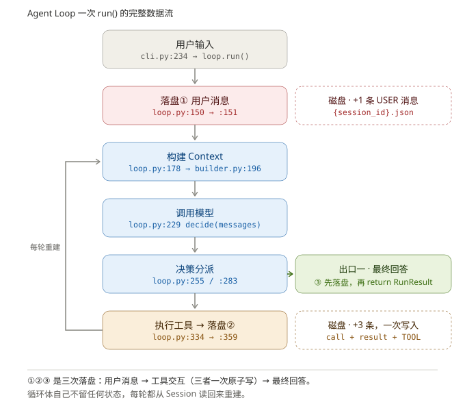

# 一个 Agent 后端的三层结构

> 这份文档按「领域层定义了什么 → 应用层需要什么能力 → 适配层怎么翻译 → 局限在哪」的顺序走完 28 个源文件。
> 每个字段、每个方法、每个数字，都交代它从哪来、解决什么问题、不这样会怎样。
> 基准：`37d951d`，`src` 3,982 行 / 28 文件，`pytest -q` → 150 passed, 4 deselected。

---

## 零、这个系统是什么

「Agent 就是一个循环。」

这句话是对的。但一个能用的 Agent 后端，循环体只占很小一部分。剩下的是：这个循环
**依赖什么**、**产出什么**、**出错了怎么办**、**怎么证明它没出错**。

这个项目把这些问题的答案拆成四层：

```
src/yjy_agent_runtime/
├── domain/          领域层：不可变对象 + 构造期不变量，零 I/O
├── agent/           应用层：主循环 + 6 个端口协议
├── infrastructure/  适配层：LLM / Session / Tool / Context / Trace 的具体实现
└── interfaces/      入口层：CLI、.env 加载、对象装配
```

规模：3,982 行 Python，28 个文件，运行时只依赖 `httpx`（HTTP）和 `jsonschema`（参数校验）。
没有 LangGraph、没有 LangChain。循环、解析、工具调度、Session、压缩、Trace 全部自己写。

依赖方向是单向的：`interfaces → infrastructure → agent → domain`。

这条不是靠自觉，是靠测试守住的。`tests/test_architecture.py:22`：

```python
ALLOWED_DEPENDENCIES = {
    "domain": set(),                        # 领域层不依赖任何内部层
    "agent": {"domain"},                    # 应用层只认识领域对象
    "infrastructure": {"domain", "agent"},  # 适配层实现应用层端口
    "interfaces": {"domain", "agent", "infrastructure"},
}
```

它用 `ast` 静态解析每个文件的 import，发现反向依赖就 fail。

**为什么要写成测试？** 因为分层最容易变成一句口号。写在文档里的约束，三个月后
没人记得；写成会红的测试，谁碰谁挂。

---

## 一、工作流：八步，每步回答一个问题

在讲结构之前，先讲这个系统要干什么。八步：

| # | 步骤 | 这一步在回答什么问题 |
| --- | --- | --- |
| 1 | 开始/继续对话 | 这次对话是谁的？之前说过什么？ |
| 2 | 收到用户消息 | 新的输入怎么进入历史？ |
| 3 | 组织上下文 | 哪些内容该发给模型，哪些该省掉？ |
| 4 | 调用模型 | 模型说"我要调工具"还是"我答完了"？ |
| 5 | 审核工具调用 | 这次调用合理吗？ |
| 6 | 执行 / 拒绝 | 真的去做，还是把拒绝理由告诉模型？ |
| 7 | 循环 | 什么时候继续，什么时候停？ |
| 8 | 持久化 | 哪一刻该落盘，落盘失败怎么办？ |

如果把这八步写成一个函数一个函数，能跑。但跑起来之后有两个问题：

- 想把模型从 A 家换成 B 家，得同时改五个地方；
- 想测流程，得真的调模型——又慢又花钱。

**分层解决的就是这两个问题：可替换、可测试。** 不是为了让目录好看。

---

## 二、三层在分什么

三层不是按文件分的，是按**工作性质**分的：

| 层 | 工作性质 | 一句话 | 判断标准 |
| --- | --- | --- | --- |
| 领域层 | **定义** | 系统自己的语言 | 换个模型、换个数据库，这层一个字都不用改 |
| 应用层 | **编排** | 先做什么、后做什么、什么时候停 | 只认识接口，不认识任何具体类 |
| 适配层 | **翻译** | 把外部的东西翻成我们的语言 | 外部协议变了，只改这一层 |

**为什么适配层和应用层都是为领域层而生的？**

因为"你怎么定义对话、工具、上下文"决定了这个系统长什么样。定义一变，上面两层
全部跟着变；反过来，上面两层换掉，定义不用动。

**翻译这个动作，举个例子最清楚。**

在我们的系统里，一次对话是一个 `Session` 对象。存到磁盘上，它是一段 JSON。
这两者长得完全不一样：

```python
# 系统里
Session(session_id="abc", messages=(Message(...), ...), summary=SessionSummary(...))

# 磁盘上
{"session_id": "abc", "messages": [{"role": "user", "content": "..."}], "summary": {...}}
```

中间必须有个人做翻译。这两个函数就是适配层存在的全部理由：

- `file.py:202` `_encode_session()` —— Session 对象 → dict
- `file.py:248` `_decode_session()` —— dict → Session 对象

没有它们，`json.loads` 和 `payload["messages"]` 就会散落在业务代码里。

下面按概念一个个走。每走完一个概念，就有一个 domain 对应的应用层和适配层被介绍完。

---

## 三、概念一：对话（Session / Message）

### 3.1 Message：四个字段，每个都在回答一个问题

**文件**：`domain/models.py:90`

```python
@dataclass(frozen=True, slots=True)
class Message:
    role: MessageRole
    content: str
    tool_call_id: str | None = None
```

| 字段 | 为什么存在 | 去掉会怎样 |
| --- | --- | --- |
| `role` | 模型要区分"谁说的"。指令、用户、助手、工具结果在协议里是四个不同位置 | 全部塞成一段文本，模型分不清哪句是自己说的、哪句是工具返回的 |
| `content` | 消息的实际载荷。用 `str` 而不是结构化对象，是因为各家协议 content 形态不同，`str` 是最小公分母 | 每种角色都要定义一套结构，适配层要为每套结构写一份翻译 |
| `tool_call_id` | 把"工具结果"对回"哪次调用"的唯一依据 | 一轮里调了三个工具，三个结果分不清谁是谁 |

`content` 用 `str` 有一个代价：工具结果的结构化信息（状态、错误类型、参数）会被
序列化成 JSON 塞进字符串（`builder.py:564` 的 `render_tool_envelope`）。这不是
偷懒——**结构化是给人看的，序列化之后是给模型看的，模型只需要读得懂。**

`role` 是个受控枚举（`models.py:41`），四个值：

```python
SYSTEM / USER / ASSISTANT / TOOL
```

`TOOL` 单独存在，是因为它有一个别的角色都没有的字段 `tool_call_id`。

**四条构造期规则**（`models.py:103`）：

```python
def __post_init__(self) -> None:
    if not self.content:
        raise ValueError("message content must not be empty")
    _ensure_no_surrogates(self.content, "message content")
    if self.role is MessageRole.TOOL and not self.tool_call_id:
        raise ValueError("tool message requires tool_call_id")
    if self.role is not MessageRole.TOOL and self.tool_call_id is not None:
        raise ValueError("only tool message may contain tool_call_id")
```

| 规则 | 解决什么问题 | 不写会怎样 |
| --- | --- | --- |
| `frozen=True` | 消息进了 Session 就不能改 | 快照在多个 Store 之间传，能原地改就可能悄悄改写历史，Trace 和实际输入对不上 |
| `content` 非空 | 空内容是纯噪音 | OpenAI 兼容接口收到空 content 直接 400；而且"空"和"无"会被混为一谈 |
| TOOL 必须有 id | 结果要能对回调用 | 工具结果成了孤儿，模型只能猜它属于哪次调用 |
| 非 TOOL 不许有 id | 反向约束 | 只写前半条，就会出现 USER 消息带着 call_id 的脏数据 |

最后两条是**成对**的。很多人只写第一条——那只防住了一个方向的脏数据，
另一个方向照样能构造出非法状态。

**`_ensure_no_surrogates` 为什么值得单独存在？**

先说清楚 surrogate 是什么。Unicode 里 `U+D800`–`U+DFFF` 这一段**不是字符**，
它是 UTF-16 用来表示辅助平面字符的"半个码元"。关键事实是：

> **合法的 UTF-8 字节序列永远解不出 surrogate。** 因为 UTF-8 的编码规则
> 明确禁止这一段（RFC 3629）。所以 `"你好"`（U+4F60 / U+597D）、任何正常输入法、
> 任何浏览器、任何文本编辑器，都产生不出它。

那它从哪来？只从**"假解码"**来——把一段非法字节硬塞进 str，最常见的两个口子：

| 路径 | 真实行为（已实测） | 结果 |
| --- | --- | --- |
| `sys.argv` | 用 `os.fsdecode`，即 `surrogateescape` | `b"\xff"` → `"\udcff"` |
| `sys.stdin` | `errors="strict"` | 抛 `UnicodeDecodeError`，**不产生** surrogate |
| 从 JSON 读回 | `json.loads` 会还原 `\udcXX` 转义 | 又变回 surrogate |
| **编码用错** | GBK 的"你好"（`b"\xc4\xe3\xba\xc3"`）被当 UTF-8 读 | `"\udcc4\udce3\udcba\udcc3"`，**4 个 surrogate** |

最后一行是最现实的场景：Windows 终端、老编辑器、跨平台粘贴，都可能让一段 GBK
字节走进 UTF-8 的通道。此时 str 里躺着 4 个 surrogate——**看起来是"你好"，
在字节层面是 4 个坏字节的痕迹**。

`surrogateescape` 的机制是"逃生舱"：它借用 `U+DC80`–`U+DCFF` 这一段，
把每个无法解码的字节原样记住（`b"\xff"` ↔ `"\udcff"`），所以能无损还原：

```python
b"\xc4\xe3\xba\xc3".decode("utf-8", "surrogateescape")   # '\udcc4\udce3\udcba\udcc3'
  .encode("utf-8", "surrogateescape").decode("gbk")      # '你好'
```

**这就是为什么这层校验不能叫"过滤生僻字符"**：它记的不是字符，是字节。

所以这条校验真正防的是 **argv / 环境变量 / 从文件读回的历史**，不是 stdin。

**它拦下来以后会发生什么？** 分两层：

- **CLI 层**（`cli.py:197`）：先检查，命中就打印一句人话、返回退出码 2——
  「输入包含无法解码的字符（终端编码可能不是 UTF-8）」，不发起任何运行。
- **领域层**（`models.py:36`）：如果绕过 CLI 直接构造对象，`ValueError` 会拦下。
  这是最后一道，不是第一道。

**为什么是 fast-fail 而不是"修一下"？**

因为可选的"修"只有两种，都比失败更糟：

- 替换成 `U+FFFD`（`�`）或 `?`：**静默篡改用户输入**，模型收到的和用户打的不是同一句话；
- 用 `errors="replace"` 在读入时就换掉：问题被藏起来，等你发现时已经查不到源头。

所以选择是：**在最早的边界上拒绝，并说清楚是编码问题。**

**不这样做会怎样？** 实测：`json.dumps(..., ensure_ascii=False)` **不会报错**
（它只是把 surrogate 留在 str 里），真正炸的是写文件那一刻的 `encode("utf-8")`：

```
UnicodeEncodeError: 'utf-8' codec can't encode character '\udcff': surrogates not allowed
```

这时候你看到的是一个 IO 错误，栈里全是 `json` / `pathlib`，而真正的原因是
"用户输入里有一个坏字节"——**排查方向完全错了。**

### 3.2 Session：五个字段，为什么不是一个 list

**文件**：`domain/models.py:226`

```python
@dataclass(frozen=True, slots=True)
class Session:
    session_id: str
    messages: tuple[Message, ...] = ()
    tool_calls: tuple[ToolCall, ...] = ()
    tool_results: tuple[ToolResult, ...] = ()
    todos: tuple[str, ...] = ()
    summary: SessionSummary | None = None
```

| 字段 | 职责 | 为什么不能合并 |
| --- | --- | --- |
| `session_id` | 所有读写的显式参数 | 没有它，状态只能挂在全局变量上，多个会话必然串线 |
| `messages` | 模型要看到的有序历史 | 它只表达"说过什么"，不表达"做过什么" |
| `tool_calls` | 模型请求过的调用 | 调用有参数、有 id，`Message` 装不下 |
| `tool_results` | 每次调用的结构化结果 | 结果有状态、错误类型、超时语义，也不该压成一段文本 |
| `todos` | 当前会话的待办 | 工具是无状态的，状态必须挂在 Session 上才能隔离 |
| `summary` | 历史压缩的摘要 + 覆盖范围 | 摘要不是消息，它有"覆盖到第几条"这个元数据 |

**`todos` 为什么放在 Session 里，而不是让 `todo` 工具自己存？**

因为工具实例是**共享的**（注册表里只有一个 `TodoTool`）。如果待办存在工具对象上，
两个会话就会看到同一份待办。放在 Session 上，`session_id` 一隔离，问题自动消失。

**`summary` 为什么不是一个字符串，而要包一层？**

```python
@dataclass(frozen=True, slots=True)
class SessionSummary:      # models.py:113
    content: str
    covered_message_count: int
```

因为摘要必须知道自己覆盖到哪。没有这个数字，就不知道哪些消息已经被摘要替代、
哪些还需要原样发送——要么重复摘要（浪费），要么漏掉（丢历史）。

**`covered_message_count` 的上界校验**（`models.py:244`）：

```python
if self.summary is not None and self.summary.covered_message_count > len(self.messages):
    raise ValueError("summary cannot cover more messages than the session contains")
```

这一行是整个压缩机制的地基。`covered` 是"摘要和最近窗口的分界线"：
`messages[:covered]` 已被摘要替代，`messages[covered:]` 原样保留。

它一旦被推过 `len(messages)`，会有两种灾难：

- 分界线越界，`messages[covered:]` 变空切片 → **模型看不到用户刚说的话**
- 或者摘要声称覆盖了并不存在的消息 → 那批消息既不在摘要里、也不在窗口里 → **永久丢历史**

这一行把这两种状态变成了"构造不出来"。

### 3.3 工具交互为什么是"三个平行结构"

这一节讲的是**一次工具调用怎么落盘**。先把三个东西在哪说清楚，再按代码执行顺序走一遍。

#### 三个东西分别是什么、在哪 

| # | 是什么 | 类型 | 定义在哪 |
| --- | --- | --- | --- |
| ① | 模型请求的调用（含参数） | `ToolCall` | `domain/models.py:128` |
| ② | 执行后的结果（含状态、错误类型、超时语义） | `ToolResult` | `domain/models.py:202` |
| ③ | 给模型看的文本（一条 `role=TOOL` 的消息） | `Message` | `domain/models.py:90` |

三者落在 `Session` 的**三个不同位置**（`domain/models.py:226`）：

```python
@dataclass(frozen=True, slots=True)
class Session:
    session_id: str
    messages: tuple[Message, ...] = ()          # ← ③ TOOL 消息混在这里
    tool_calls: tuple[ToolCall, ...] = ()       # ← ①
    tool_results: tuple[ToolResult, ...] = ()   # ← ②
    todos: tuple[str, ...] = ()
    summary: SessionSummary | None = None
```

所以严格说是**两个 tuple + 消息流里的一条消息**，靠 `call_id` 关联。

**为什么不学"普通写法"：把 ①② 塞进一条 `AssistantMessage(text, tool_calls=[...])`？**

因为普通写法是"逐个执行、逐个写结果"。执行到第二个，进程被 kill，磁盘上就是
**一条声称调了 3 个工具的消息 + 1 个结果**。下一轮读回来，模型看到"我说要调
c2、c3，但没有结果"，它只能瞎猜。

#### 一次写入，按代码执行顺序走（7 步）

下面每一步都给出**具体文件、函数、行号**，顺着读就是一次完整的落盘。

| 步 | 位置 | 函数 | 做什么 |
| --- | --- | --- | --- |
| 1 | `agent/loop.py:334` | `AgentLoop.run` | `tool_result = self._tool_executor.execute(request.session_id, call)` —— 拿到 ② |
| 2 | `agent/loop.py:359` | `AgentLoop.run` | 调 `self._session_store.append_tool_interaction(session_id, call, tool_result, Message(TOOL, ...))` —— **一次传四样** |
| 3 | `infrastructure/session/file.py:90` | `JsonFileSessionStore.append_tool_interaction` | 进入具体实现（应用层只认识 `ports.py:127` 的协议） |
| 4 | `file.py:104` | 同上 | `validate_tool_interaction(call, result, message)` —— **闸门二**，三者必须互相指认 |
| 5 | `file.py:105` → `:106` | 同上 | `self._require(session_id)` 读当前快照；`ensure_unique_call_id(current, call)` —— `call_id` 不能重复 |
| 6 | `file.py:107-114` | 同上 | 构造**新的** `Session`：三个位置各追加一项，其余原样带过来 |
| 7 | `file.py:116` → `:156` `_save` | 同上 → `_save` | 落盘：`:164` 写临时文件 → `:175` `fsync` → `:177` `os.replace` 原子替换 |

第 6 步那段代码值得看原文，因为它把"三个平行结构"写得最直白：

```python
updated = Session(
    session_id=session_id,
    messages=(*current.messages, message),        # ③ 追加一条
    tool_calls=(*current.tool_calls, call),       # ① 追加一条
    tool_results=(*current.tool_results, result), # ② 追加一条
    todos=current.todos,
    summary=current.summary,
)
```

**三个 `(*current.x, y)` 在同一个表达式里，这就是"原子"在代码层面的样子**——
不存在"先追加 ① 再追加 ②"的中间状态，因为整个 `Session` 是一次性构造出来的
新对象（`frozen=True`）。

#### 三道闸门，分别是谁

| 闸门 | 函数 | 定义在 | 被谁调用 | 挡住什么 |
| --- | --- | --- | --- | --- |
| 一 | `reject_standalone_tool_message` | `session/invariants.py:24` | `file.py:77`、`in_memory.py:46` | 单独 append 一条 TOOL 消息 |
| 二 | `validate_tool_interaction` | `session/invariants.py:37` | `file.py:104`、`in_memory.py:73` | 调用/结果/消息不是同一次交互 |
| 三 | `assert_tool_interactions_consistent` | `session/invariants.py:61` | `file.py:61` | 读回来的旧快照本身是残缺的 |

闸门一在 `append_message` 里（`file.py:76` 那个函数），不在 `append_tool_interaction`
里——**因为它是用来堵另一条路的**：

```python
def append_message(self, session_id: str, message: Message) -> Session:
    reject_standalone_tool_message(message)      # file.py:77
```

如果 TOOL 消息能走 `append_message`，那"一次写完"就形同虚设——调用方可以绕过去。
所以这里的态度是：**不是"请你别这么写"，是"这条路我封了"。**

#### 一次读取，按代码执行顺序走（4 步）

| 步 | 位置 | 做什么 |
| --- | --- | --- |
| 1 | `file.py:43` `get()` | 按 `session_id` 定位文件（文件名是 sha256，见 `:188`） |
| 2 | `file.py:50` | `json.loads(path.read_text(encoding="utf-8"))` —— 字符串变 dict |
| 3 | `file.py:51` → `:247` `_decode_session` | dict 变 `Session`：逐条重建 `Message` / `ToolCall` / `ToolResult` |
| 4 | `file.py:61` | `assert_tool_interactions_consistent(session)` —— **闸门三** |

第 4 步失败会包成 `SessionStorageError`（`file.py:63`），而不是让一条残缺历史
流进 Context：

```python
try:
    assert_tool_interactions_consistent(session)
except ValueError as error:
    raise SessionStorageError(f"session snapshot has an incomplete tool interaction: {session_id}") from error
```

它查三件事（`invariants.py:61`）：调用 ID 不重复、每个结果都能对上一个同名调用、
每条 TOOL 消息都能同时对上调用和结果。

#### 代价，必须说清楚

历史里没有"带 tool_calls 的 assistant 消息"。所以发给模型时，工具结果只能以
`TOOL` 角色出现，而 OpenAI 协议没有对应位置，适配器只能把它改写成 `USER` 消息
（`openai_compatible.py:197`）。这是**故意放弃供应商原生 tool 角色**换来的代价，
换来的是控制流完全在本地。

### 3.4 应用层：七个方法，每个都有明确边界

**文件**：`agent/ports.py:108`

```python
class SessionStore(Protocol):
    def get(self, session_id: str) -> Session | None: ...
    def get_or_create(self, session_id: str) -> Session: ...
    def append_message(self, session_id: str, message: Message) -> Session: ...
    def append_tool_interaction(self, session_id, call, result, message) -> Session: ...
    def set_summary(self, session_id: str, summary: SessionSummary | None) -> Session: ...
    def append_todo(self, session_id: str, todo: str) -> Session: ...
    def list_todos(self, session_id: str) -> tuple[str, ...]: ...
```

| 方法 | 为什么需要 | 为什么不能合并进别的 |
| --- | --- | --- |
| `get` | 读快照，不存在返回 `None` | 和 `get_or_create` 分开，是因为"不存在"有时是**正常情况**（首次访问），有时是**错误**（更新一个不存在的会话） |
| `get_or_create` | 幂等地开始一次对话 | 让调用方不必先判断再创建，避免 TOCTOU |
| `append_message` | 追加一条非工具消息 | 只有"追加"，没有"覆盖" |
| `append_tool_interaction` | 一次写三样 | 单独写会产生半条交互 |
| `set_summary` | 设置或清除摘要 | 摘要不是消息，不能 append |
| `append_todo` / `list_todos` | 待办的读写 | 待办不属于消息流 |

**这里没有 `save(session)`，是刻意的。**

给一个"把整个 Session 存回去"的方法，等于把写权限交给调用方。谁能 `save`，
谁就能把 `messages` 改短、把 `covered` 改大——而这些恰恰是最需要守住的不变量。

**所有方法都显式带 `session_id`。** 没有"当前会话"这种隐式状态，所以不存在
"A 窗口的消息跑到 B 窗口"这种问题。这不是靠加锁解决的，是靠**没有地方可以藏**。

### 3.5 适配层：翻译 + 原子写入

**`in_memory.py`（139 行）** —— 进程内实现，测试用。换快照就是换一个引用，
天然原子：要么新快照可见，要么旧快照还在。

**`file.py`（298 行）** —— 真实存储。两个细节值得停一下。

**细节一：文件名是 sha256**（`file.py:193`）

```python
digest = hashlib.sha256(session_id.encode("utf-8")).hexdigest()
return self._directory / f"{digest}.json"
```

为什么不直接拼 `session_id`？因为它来自命令行，可能包含 `/`、`..`。直接拼会越出
目录，或者产生非法文件名。哈希之后既安全，又保持"一个 Session 一个文件"。

代价是**丢了"列出所有会话"的能力**——哈希之后没法反查原始 ID。这是一个明确的取舍。

**细节二：写入是"临时文件 + fsync + 原子替换"**（`file.py:165`）

```python
with tempfile.NamedTemporaryFile(mode="w", dir=self._directory, delete=False) as temporary:
    json.dump(payload, temporary, ensure_ascii=False, sort_keys=True)
    temporary.flush()
    os.fsync(temporary.fileno())
    temporary_path = temporary.name
os.replace(temporary_path, path)
```

三步各自解决一个问题：

| 步骤 | 解决什么 | 去掉会怎样 |
| --- | --- | --- |
| 临时文件 | 不破坏已有文件 | 直接写目标文件，写到一半崩溃就留下半个 JSON |
| `fsync` | 数据真正落盘，不只在页缓存里 | 断电后文件可能为空 |
| `os.replace` | 原子替换（POSIX 保证） | 复制/删除两步之间崩溃，文件消失 |

`sort_keys=True` 也有用处：同一个 Session 两次保存的字节序一致，diff 和比对才有意义。

**`invariants.py`（88 行）** —— 两个 Store 共用的规则。

为什么单独抽一个文件？因为内存版和文件版都要做同样的校验。写两遍，迟早有一遍
会漂移；漂移的那一遍就是漏洞。

### 3.6 局限

| 局限 | 现状 | 原因 |
| --- | --- | --- |
| 没有 `list_sessions()` | 只有 `get` / `get_or_create` | 文件名哈希后没法反查。补法：扫目录读文件里的 `session_id` 字段（已经存了，`file.py:203`），或加索引 |
| 没有跨进程并发控制 | 只有 `RLock`，只在单进程内有效 | 两个进程同时写同一个 Session 会互相覆盖。生产要文件锁或数据库 |
| `Session` 只增不减 | 消息只追加不删除 | 靠 Context 压缩（不发出去），不靠 Session 瘦身。**这是有意的**：历史是审计事实，不该删 |

---

## 四、概念二：工具（Tool）

### 4.1 ToolDefinition：四个字段

**文件**：`agent/ports.py:24`

```python
@dataclass(frozen=True, slots=True)
class ToolDefinition:
    name: str
    description: str
    parameters: Mapping[str, Any] = field(default_factory=dict)
    has_side_effects: bool = False
```

| 字段 | 谁在用 | 为什么必须有 |
| --- | --- | --- |
| `name` | 注册表（唯一键）、模型（调用时填） | 模型只能通过名字指定要调哪个工具 |
| `description` | 模型 | 这是模型判断"该不该用这个工具"的唯一依据 |
| `parameters` | 模型（生成参数）、执行器（校验） | 一份 JSON Schema，同时当"说明书"和"校验器"用 |
| `has_side_effects` | 执行器（决定怎么执行） | 见 4.4，它决定"超时意味着什么" |

`parameters` 用 `MappingProxyType` 包一层只读（`ports.py:44`）：

```python
object.__setattr__(self, "parameters", MappingProxyType(dict(self.parameters)))
```

为什么？因为这份 Schema 会被序列化进每一轮的系统提示。运行期间被谁改一个字段，
模型的输入就悄悄变了，而 Trace 里看不出差异。

**`parameters` 一份 Schema 当两个用**：模型看它生成参数，`jsonschema.validate`
用它校验参数。**同一个真相源**——如果说明书和校验器是两份，迟早对不上。

### 4.2 Tool 协议：两个成员

```python
class Tool(Protocol):                        # ports.py:51
    @property
    def definition(self) -> ToolDefinition: ...
    def invoke(self, arguments: Mapping[str, Any]) -> str: ...
```

**为什么是 `property` 而不是普通属性？** 因为大多数工具的 definition 是常量，
用 property 可以让类属性 `_definition` 只构造一次，而不是每个实例一份。

**为什么 `invoke` 只收 `arguments`，不收 `session_id`？**

因为大多数工具不需要会话。只有 `todo` 需要——它要读写当前会话的待办。所以
`todo` 额外实现了 `invoke_with_session(session_id, arguments)`，执行器用
`hasattr` 探测（`executor.py:151`）。

这是一个刻意的"能力探测"而不是"接口膨胀"：如果协议里直接写
`invoke(session_id, arguments)`，那 3 个不需要会话的工具都得接受一个它们永远
不用的参数——**参数里出现一个永远不用的值，是接口设计出错的信号**。

### 4.3 应用层：ToolExecutor 只有一个方法

```python
class ToolExecutor(Protocol):               # ports.py:100
    def execute(self, session_id: str, call: ToolCall) -> ToolResult: ...
```

只有一个方法，但它背后要回答两个完全不同的问题：

1. **参数合法吗？** —— 调用前用 JSON Schema 校验，非法参数不进入工具实现
2. **超时意味着什么？** —— `join(timeout)` 只是"不再等待"，线程还在跑

这两个问题不能混在一起答。第一个是"输入是否可信"，第二个是"外部状态是否已改变"。

**返回值为什么是 `ToolResult` 而不是 `str`？** 因为失败也要带着信息回来：
状态、错误类型、超时语义。只返回字符串，失败就只剩一句话，调用方没法分类处理。

### 4.4 执行器：四道关，一条直线

**文件**：`infrastructure/tools/executor.py:66`

```python
def execute(self, session_id: str, call: ToolCall) -> ToolResult:
    if not session_id:
        raise ValueError("session id must not be empty")

    try:
        tool = self._registry.get(call.name)          # ① 注册表
    except KeyError as error:
        return self._error_result(call, "UnknownToolError", str(error))

    try:
        validate(instance=dict(call.arguments),
                 schema=dict(tool.definition.parameters))   # ② Schema
    except ValidationError as error:
        return self._error_result(call, "ToolArgumentsValidationError", error.message)
    except SchemaError as error:
        return self._error_result(call, "InvalidToolSchemaError", error.message)

    try:
        content, semantics = self._dispatch(tool, session_id, call.arguments)  # ③ 执行
    except ToolExecutionTimeout as error:
        return self._error_result(call, "TimeoutError", str(error), semantics=error.semantics)
    except Exception as error:
        return self._error_result(call, type(error).__name__, str(error) or "tool execution failed")

    if not isinstance(content, str):                  # ④ 结果校验
        return self._error_result(call, "InvalidToolResultError", "tool result must be a string", semantics=semantics)
    if not content:
        return self._error_result(call, "InvalidToolResultError", "tool result must not be empty", semantics=semantics)

    return ToolResult(..., status=ToolResultStatus.SUCCESS, content=self._limit_content(content), ...)
```

| 关 | 挡住什么 | 返回的错误类型 |
| --- | --- | --- |
| ① 注册表 | 模型编了一个不存在的工具名 | `UnknownToolError` |
| ② Schema | 缺必填参数、类型错、多传了字段 | `ToolArgumentsValidationError` |
| ③ 执行 | 工具内部抛异常、超时 | 原异常类型名 / `TimeoutError` |
| ④ 结果 | 工具返回了非字符串或空字符串 | `InvalidToolResultError` |

**四道关全部返回 `ToolResult`，一个都不抛异常。**

这是整个项目最重要的一条设计原则：

> 工具失败是一个**可观察的事实**，不是程序崩溃。

模型需要看到"这个工具报错了、错在参数"，才能决定换参数重试还是换方案。
把异常抛出去终止循环，等于剥夺了模型的纠错能力。

**`SchemaError` 和 `ValidationError` 为什么要分开？** 前者是"工具的 Schema 本身写错了"
（开发者的 bug），后者是"参数不符合 Schema"（模型的错）。混成一个，排查时
分不清该改代码还是该改提示。

### 4.5 三种超时语义，每个值都在回答一个问题

```python
class TimeoutSemantics(StrEnum):            # models.py:183
    SYNCHRONOUS = "synchronous"
    ABANDONED_SAFE = "abandoned_safe"
    COOPERATIVE = "cooperative"
```

为什么需要这个枚举？因为 `status=error + error_type=TimeoutError` 是**歧义**的：

- 对 `calculator`：没算出来，什么都没发生
- 对 `todo add`：我告诉你失败了，但两秒后待办真写进去了

同一个 `ToolResult`，两种截然不同的外部事实。

| 值 | 含义 | 什么时候产生 |
| --- | --- | --- |
| `SYNCHRONOUS` | 有副作用工具在调用线程同步执行，**根本没有超时** | 工具标了 `has_side_effects` 但没实现协作截止时间 |
| `ABANDONED_SAFE` | 无副作用工具等待超时，线程被放弃，**但它按约定不改变外部状态** | 无副作用工具超时 |
| `COOPERATIVE` | 有副作用工具带 `Deadline`，超时后会在写入前检查并放弃提交 | 工具实现了 `invoke_with_session_deadline` |

**为什么 `SYNCHRONOUS` 这一支存在？**

因为 Python 无法从外部安全地杀死一个正在执行写操作的线程。对一个会写文件、
发请求的工具，`join(timeout)` 之后线程还在跑——这时候如果报告"超时失败"，
两秒后它真的写完了，就会出现"已向模型报告失败、稍后却真的写入了"这种
**不可解释的状态**。

所以：**不能协作的工具，就不给它超时。** 宁可慢，也不谎报已取消。

分流逻辑（`executor.py:142`）：

```python
if tool.definition.has_side_effects:
    if hasattr(tool, "invoke_with_session_deadline"):
        return self._invoke_cooperatively(tool, session_id, arguments)   # COOPERATIVE
    return self._invoke_inline(tool, session_id, arguments), TimeoutSemantics.SYNCHRONOUS
if hasattr(tool, "invoke_with_session"):
    return self._invoke_with_timeout(tool, (session_id, arguments), session_aware=True), TimeoutSemantics.ABANDONED_SAFE
return self._invoke_with_timeout(tool, arguments), TimeoutSemantics.ABANDONED_SAFE
```

**`Deadline` 怎么工作**（`tools/deadline.py`）：

```python
class Deadline:
    def __init__(self, timeout_seconds: float) -> None:
        self._expires_at = monotonic() + timeout_seconds

    def raise_if_expired(self) -> None:
        if self.expired:
            raise TimeoutError("tool deadline exceeded before commit")
```

约定是：**工具在真正产生外部副作用之前，必须调用 `raise_if_expired()`。**
这样"执行器已经报告超时"和"工具稍后又写了一次"就不会同时发生。

用 `monotonic()` 而不是 `time()`，因为系统时钟会被 NTP 调整——**超时判断不能
受时间回拨影响**。

### 4.6 注册表：40 行，三件事

**文件**：`tools/registry.py:15`

```python
def register(self, tool):      # 重名直接拒绝
def get(self, name):           # 未知名字抛 KeyError
def definitions(self):         # 给 LLM 看的只读视图
```

**`register` 为什么拒绝重名而不是覆盖？** 覆盖会让"我注册了但没生效"变成静默行为。
一个工具被另一个同名工具顶掉，症状是"模型调的工具行为不对"——这种 bug 极难查。

**`get` 为什么抛 `KeyError` 而不是返回 `None`？** 因为"找不到工具"和"工具返回 None"
是两件事。返回 `None` 会让调用方多写一个 `if`，而忘了写就变成 `AttributeError`。

**`definitions()` 为什么返回 tuple？** 因为注册顺序就是提示里工具的顺序。
返回 list，调用方可能原地排序，然后"为什么提示里的顺序变了"。

### 4.7 四个工具，以及 calculator 的五道闸门

**`builtin.py`（246 行）**：

| 工具 | 副作用 | 用途 |
| --- | --- | --- |
| `echo`（`:12`） | 无 | 验证工具调用链路（最小可用） |
| `calculator`（`:34`） | 无 | 受限 AST 算术 |
| `search`（`:147`） | 无 | 本地 mock 文档检索，明确不联网 |
| `todo`（`:186`） | **有** | 当前会话的待办增/查 |

**`calculator` 为什么需要五道闸门？**

因为 `9**9**9` 在语法上完全合法，但会让解释器算到天荒地老。一次工具调用就能
拖垮整个进程。所以任何一道超限都立即失败，绝不"先算完再说"：

| 闸门 | 上限 | 挡住什么 |
| --- | --- | --- |
| 表达式长度 | 200 字符 | 超长输入 |
| 嵌套深度 | 32 层 | `((((1))))` 式的深递归（会先撞 Python 递归上限） |
| 指数绝对值 | 64 | `9**9**9`（指数本身 387420489，先被这里拒绝） |
| 整数结果位数 | 1024 bit | 中间结果爆炸式增长 |
| 浮点结果量级 | 1e100 | 同上 |

代码注释（`builtin.py:58`）写得很老实：**"数值取自'够用且明显安全'，不是性能
调优的结果。"** 这句话本身就是回答——被问"为什么是 64 不是 128"时，答案不是
"我调优过"，而是"这是一个明确的安全边界，不是性能参数"。

### 4.8 局限

| 局限 | 现状 | 原因 / 补法 |
| --- | --- | --- |
| **没有 `BashTool`** | 只有 echo / calculator / search / todo | **故意的。** 没有沙箱就暴露 shell，等于把 `rm -rf` 交给模型。要做得先有容器隔离 + 白名单 + 审批 |
| 多工具串行 | `for call in decision.tool_calls`（`loop.py:317`） | 并发会引入"部分成功"的中间态，落盘顺序和 `call_id` 顺序不一致，校验更复杂。要并发的前提是先把 `append_tool_interaction` 改成批量原子写 |
| 没有工具级权限 | 只有 `has_side_effects` 一个布尔 | 真正的权限模型要"谁能调哪个工具"，现在是"这个工具会不会改外部状态" |

---

## 五、概念三：上下文（Context）

### 5.1 这里没有 Context 类

先说清楚：**这个项目没有 `Context` 对象。**

一个常见的写法是 `Context[O]` 泛型，装 `instruction`、`tools`、`messages`、
`output_type` 四个字段，让同一个 `generate()` 既回复用户又审核工具。

这个项目把它们拆散了：

| 常见写法里的字段 | 这个项目在哪 |
| --- | --- |
| `instruction` | `ContextConfig.system_prompt`（`builder.py:134`） |
| `tools` | 序列化成 JSON 拼进同一条 system 消息（`builder.py:407`） |
| `messages` | `ContextProvider.build()` 的返回值 |
| `output_type` | **没有**，由 `LLMClient.decide()` 的返回类型固定 |

**为什么不用泛型 Context？** 三条理由，从强到弱。

**理由一：泛型会把"解析"推给适配器。**

`generate(context[O]) -> O` 意味着适配器要按 `O` 解析。一旦 `O` 是联合类型，
适配器里就会出现 `if output_type is ...` 的分支——**类型参数在运行时被当标签用**，
泛型只买到了 IDE 提示，没买到真正的安全。

这个项目的做法：解析集中在 `_decode_decision()`（`openai_compatible.py:219`），
返回一个**封闭联合**：

```python
type AgentDecision = FinalAnswerDecision | ToolCallDecision    # models.py:173
```

循环里 `isinstance` 分派（`loop.py:255` / `:194`），非法类型落到 `INVALID_DECISION`。
**出口是穷举的，靠联合类型而不是泛型约束。**

**理由二：`instruction` 和 `tools` 最终都要变成字符串。**

`builder.py:407`：

```python
encoded = json.dumps(definitions, ensure_ascii=False, sort_keys=True)
return f"{self._config.system_prompt}\n可用工具定义：{encoded}"
```

既然是拼字符串，那三个字段就没必要存在——它们只在拼的那一刻有意义。

`sort_keys=True` 是为了**同一组工具每次序列化结果一致**。否则 prompt 前缀每次都变，
任何前缀缓存都失效，Trace 对比也做不了。

**理由三：少一层抽象，就少一处能骗过测试的地方。**

`Context` 是纯数据容器，它自己的正确性没法测，只能测"用它的人"。
`ContextProvider` 是**行为**——`tests/test_agent_loop.py:28` 的 `StubContextProvider`
可以直接替换它，整个循环不用碰模型。

### 5.2 应用层：一个方法

```python
class ContextProvider(Protocol):            # ports.py:68
    def build(self, request: RunRequest, tool_results: Sequence[ToolResult]) -> Sequence[Message]: ...
```

**为什么参数里要传 `tool_results`？** 因为本轮刚执行完的工具结果还没被下一轮
读到——虽然循环已经把它写进 Session 了，但传一份显式的可以让 Context 实现
不必重新扫全量历史。

**为什么返回 `Sequence[Message]` 而不是一个 Context 对象？** 因为下游
（`LLMClient.decide`）只接受 `Sequence[Message]`。中间多一个对象，就要多一次转换。

### 5.3 ContextConfig：五个参数，每个数字从哪来

**文件**：`builder.py:131`

```python
@dataclass(frozen=True, slots=True)
class ContextConfig:
    system_prompt: str = "你是一个可靠的 Agent Runtime 助手。"
    max_history_messages: int = 20
    max_tool_result_chars: int = 2_000
    max_summary_chars: int = 4_000
    max_context_chars: int = 24_000
```

| 参数 | 值 | 从哪来 | 调大 / 调小会怎样 |
| --- | --- | --- | --- |
| `max_history_messages` | 20 | 一次工具交互至少占 2 条消息（TOOL 消息 + 可能的前置 assistant）。20 条约等于 6-10 轮对话 | 调到 10 以下，压缩几乎每轮都触发，摘要器调用变频繁；调到 40 以上，最近窗口本身就吃掉大部分预算，压缩反而更早触发 |
| `max_tool_result_chars` | 2000 | 这是"发给模型"的上限。执行器已经把它限制在 10000（落盘用），这里是第二道、更小的闸门 | 太小，模型看不清工具返回的结构，容易重复调用；太大，一条工具结果就能挤掉整段历史 |
| `max_summary_chars` | 4000 | 摘要替代的是"所有已移出窗口的历史"。4000 约等于 20 条消息的三分之一，压缩比 3:1 起步 | 太小，早期事实丢失，模型忘了用户最初的要求；太大，摘要自己就吃掉预算 |
| `max_context_chars` | 24000 | 总闸门。24000 字符约等于 8k-12k token（中英混合），远低于主流模型的 128k 窗口 | 设到接近窗口上限是危险的：字符≠token，估不准就要留余量；而且上下文越长，延迟和成本线性上升，收益递减 |

**为什么两个工具结果上限（2000 / 10000）不一样？**

因为它们服务两个不同的读者：

- **落盘 / ToolResult** 是给**审计**看的，要完整——所以 10000。
- **Context** 是给**模型**看的，只需要够判断——所以 2000。

同一个东西，两个读者，两个精度。用一个上限服务两个读者，必然有一边不舒服。

**为什么单位是字符而不是 token？**

精确 token 要接各家 tokenizer，不同模型还不一样。字符数是保守近似——中文场景
一个汉字约 1-2 token，英文约 4 字符 1 token，用字符做预算会**高估**中文、
**低估**英文，但方向一致，不会突然失控。

这是一个明确的精度取舍：**宁可粗一点但永远可算，不要精确但依赖外部服务。**

`__post_init__` 里的校验（`builder.py:140`）还额外挡住了 `bool` 和 `0`：

```python
def _require_positive_int(name: str, value: int) -> None:
    if isinstance(value, bool) or not isinstance(value, int) or value < 1:
        raise ValueError(f"{name} must be a positive integer")
```

为什么要单独判 `bool`？因为 `isinstance(True, int)` 是 `True`。`max_context_chars=True`
会静默变成一个预算为 1 的配置，然后每一轮都 `context_error`。

### 5.4 三层压缩，从粗到细

核心概念只有一个（`builder.py:244`）：

```python
covered = original_covered
# messages[:covered] 已被摘要替代，不再进入模型输入
# messages[covered:] 是最近窗口，原样保留
```

**`covered` 是分界线，不是计数器。** 它只能单调递增，否则同一批消息会被重复摘要。

送给模型的消息顺序是固定的四段（`builder.py:203`）：

```text
[system] 角色约束 + 工具名称/描述/参数 Schema
[system] 较早历史摘要              ← 可选，受 max_summary_chars
[最近消息 ...]                     ← 受 max_history_messages
[TOOL 信封 ...]                    ← 受 max_tool_result_chars
```

**为什么摘要要放在 system 位置？**

因为它是"对更早历史的替代"，不是"某一方说的话"。放在 user 位置会让模型以为
用户又说了什么；放在 system 位置，它天然被读成"背景信息"。

**三层，从粗到细：**

| 层 | 触发条件 | 代码 | 做什么 |
| --- | --- | --- | --- |
| 1 | 消息条数 > 20 | `:247-264` | 把移出窗口的旧消息**整批**摘要 |
| 2 | 总字符 > 24000 | `:274-292` | 按**完整消息组**继续往摘要里推 |
| 3 | 还是超 | `:296-316` | 只缩短摘要的**展示长度**，最近消息不动 |
| 兜底 | 只剩最后一组仍超 | `:321-324` | 抛 `ContextBudgetError` → `context_error` 终止 |

**为什么是三层而不是一层？** 因为三种超标的原因不同：

1. 条数超标但每条都短 → 摘要旧的就行，总字符其实不超
2. 条数没超但某条特别长 → 得继续往摘要里推
3. 推到底了还超 → 只剩"缩短摘要展示"这一条路

**每一层解决一种原因，而不是用一个阈值糊住三种情况。**

第三层为什么"只改展示不改存储"？因为它**不动 `covered`**，只改这次发出去时
摘要多长。存储的摘要仍受 `max_summary_chars` 约束——**展示预算和存储预算是两个东西**。

### 5.5 消息组：为什么不能拆开摘要

`_message_groups()`（`builder.py:479`）把消息划组：

- 连续的 TOOL 消息 = 一组
- 紧邻 TOOL 之前的 ASSISTANT = 工具调用声明，与结果同组
- 其它各自成组

**为什么必须分组？** 因为如果只把 TOOL 结果摘要掉、却留下调用声明（或反过来），
模型会看到"有调用没结果"或"有结果没调用"的残缺历史，容易误判下一步。

分组保证一次工具交互**要么完整保留，要么完整进摘要**。

所以第一层的取整要向下对齐（`builder.py:251`）：

```python
target_count = max(covered, self._group_floor(session.messages, target_count))
```

`_group_floor()`（`:511`）把目标下标向下取到组边界——不能摘半个工具交互。

第二层同理，用 `_next_group_boundary()`（`:524`）一组一组往前推，并且用
`_last_group_start()`（`:536`）保证**最后一组永远不进摘要**——它是当前轮次的
上下文，摘掉就等于把用户刚问的问题删了。

### 5.6 摘要失败不推进覆盖范围

`builder.py:326`：

```python
# 只有成功组装后才落盘，失败时覆盖范围保持原值，下一轮可重试。
if summary_content is not None and (covered > original_covered or ...):
    self._session_store.set_summary(session.session_id,
        SessionSummary(summary_content, covered_message_count=covered))
```

摘要先在内存里累积，整个 Context 组装成功才写回 Session。

**为什么？** 因为如果边摘要边写，摘要器在中途抛错，就会留下
"覆盖范围前进了、摘要却没写完"的坏状态——那批消息既不在摘要里、也不在窗口里，
**永久丢失**。

这是一个典型的"要么全成、要么全不动"：内存里算完，一次提交。

### 5.7 摘要器：为什么是抽取式

`ExtractiveHistorySummarizer`（`builder.py:149`）做的是拼接 + 截断，
**一次模型调用都不发**：

```python
lines = [previous_summary] if previous_summary else []
lines.extend(f"{label}：{message.content}" for message in messages)
return truncate_summary("\n".join(lines), self._max_summary_chars)
```

**为什么不用模型做摘要？**

因为压缩发生在**构建 Context 的路径上**。如果这里再调一次模型，模型超时就会让
整个 Context 构建失败，一轮对话直接挂掉。用一个必然成功的抽取式摘要器，至少
保证"压缩永远不阻塞对话"。

而且端口留好了（`ports.py:80`）：

```python
class HistorySummarizer(Protocol):
    def summarize(self, previous_summary: str | None, messages: Sequence[Message]) -> str: ...
```

换成一个 LLM 摘要器只需要实现这个方法，`ContextBuilder` 一行都不用改。
**这是"知道该怎么做，但选择了更便宜实现"的一处。**

`truncate_summary`（`builder.py:69`）还有一个细节：截断时**首尾各保留一半**，
中间插标记。为什么？因为最早写入的事实和最近的内容都重要，只留开头会丢掉
最新的进展，只留结尾会丢掉最初的需求。

### 5.8 局限

| 局限 | 说明 |
| --- | --- |
| 摘要器不调模型 | 抽取式拼接，质量不如 LLM 摘要。见 5.7 |
| 预算单位是字符 | 不是 token。保守近似，不是准确值 |
| 单条超长消息直接失败 | 一次粘贴几万字会 `context_error`。这是有意的：宁可明确失败，也不把用户输入改得面目全非 |

---

## 六、概念四：模型（ModelClient）

### 6.1 模型输出什么：一个决策，不是一段文本

```python
class FinalAnswerDecision:   answer: str; decision_summary: str = ""      # models.py:145
class ToolCallDecision:      tool_calls: tuple[ToolCall, ...]; decision_summary: str = ""  # models.py:158

type AgentDecision = FinalAnswerDecision | ToolCallDecision               # models.py:173
```

**为什么是两个类而不是一个带 `type` 字段的类？**

因为 `isinstance` 分派比字符串比较安全：拼错一个字符串是运行时静默失败，
拼错一个类名是 `NameError`。而且两个类各自的字段不同，塞一个类里会有一半字段
永远是 `None`。

**`ToolCallDecision` 的校验**（`models.py:165`）：

```python
call_ids = [call.call_id for call in self.tool_calls]
if len(call_ids) != len(set(call_ids)):
    raise ValueError("tool call ids must be unique within one decision")
```

同一轮里两个 `call_id` 重复，结果就分不清是谁的。这条校验在构造期就拦住。

**`ToolCall.call_id` 是谁给的？**

原生 function calling 里，id 由供应商生成。这个项目走 JSON 协议，模型不会给 id，
所以适配器本地造（`openai_compatible.py:251`）：

```python
call_id=f"call-{index}-{os.urandom(4).hex()}"
```

`index` 保证同一轮内可读且有序，`urandom` 保证跨轮、跨会话不撞。
**为什么要带随机部分？** 因为如果只用 index，两轮各调一个工具都会生成
`call-1`，写进同一个 Session 就撞了——而 `ensure_unique_call_id`（`invariants.py:54`）
会直接抛错。

### 6.2 应用层：一个方法，一个参数

```python
class LLMClient(Protocol):                  # ports.py:92
    def decide(self, messages: Sequence[Message]) -> AgentDecision: ...
```

**为什么只有一个参数？** 因为指令和工具定义已经拼进第一条 system 消息了
（5.1 的理由二）。多传一个 `tools` 参数，适配器还要再拼一次，两处拼接必然漂移。

**这里有一个真缺口**：没有 `ModelSettings`，也没有思考深度档位。模型名、超时、
base_url 全在 `OpenAICompatibleConfig`（`openai_compatible.py:52`）里，构造时一次定死。

这意味着**做不到"回复用强模型、审核用便宜模型"**，因为整个运行只有一个
`LLMClient` 实例。

补起来很小：`decide(messages, settings)` 加一个参数，`LoopConfig` 放两份 settings，
`loop.py:229` 调用时选一份。适配器里把 `effort` 翻译成各家字段——OpenAI 叫
`reasoning_effort`，Anthropic 叫 `output_config.effort`。**这个翻译动作正是适配层
存在的理由。**

### 6.3 适配层：三段翻译

**文件**：`infrastructure/llm/openai_compatible.py`（260 行）

`decide()`（`:137`）只做三件事：发 HTTP、取 `choices[0].message.content`、
`json.loads` 后解析成领域对象。**它不做循环，不做工具调度，不做重试。**

**翻译一：TOOL 消息 → USER 消息**（`:197`）

```python
if message.role is MessageRole.TOOL:
    content = f"工具执行结果（调用 {message.tool_call_id}）：{message.content}"
    encoded.append({"role": MessageRole.USER.value, "content": content})
```

我们内部有 `TOOL` 角色，OpenAI 协议没有对应位置（它的 tool 角色要求
`assistant.tool_calls` 严格配对，而我们不用原生 tool_calls）。所以这里必须翻译。
`call_id` 保留在文本里，模型仍然能把结果和调用对上。

**翻译二：注入决策协议**（`:204`）

```python
protocol = (
    'Runtime 决策协议：只返回 JSON 对象。最终回答格式：'
    '{"type":"final_answer","answer":"...","decision_summary":"公开摘要"}。工具调用格式：'
    '{"type":"tool_calls","tool_calls":[{"name":"...","arguments":{...}}],...}。'
    'decision_summary 只能是简短公开摘要，不得输出私有思维链；不得输出 JSON 以外的文本。'
)
```

**为什么不直接用供应商原生 function calling？**

因为用了它，"模型决定调什么工具并自动循环"的关键流程就有一半在供应商手里了。
把决策解析放在本地，模型只负责产出 JSON，Runtime 负责校验、执行、循环——
**控制流才完全在自己手里**。

代价是拿不到协议层的配对校验，所以在 `invariants.py` 自己补了三道。

**翻译三：JSON → 领域对象**（`_decode_decision`，`:219`）

逐字段检查类型，任何一处不对就抛 `LLMResponseError`。这个函数把"外部格式"
挡在领域之外——**领域层永远不会收到一个类型不对的字段**。

### 6.4 两个超时数字

```python
timeout_seconds: float = 120.0          # 读取预算
connect_timeout_seconds: float = 10.0   # 连接预算
```

**为什么分开？** 因为两件事的失败模式不同：

- 地址不可达，应该在 10 秒内知道，而不是挂 120 秒
- 模型读完整上下文再生成，真实网关在多轮工具调用中经常超过 30 秒

代码注释（`openai_compatible.py:56`）写明了这个取舍：120 是"等待模型读完并返回"
的预算，不是所有阶段共用的总超时。

`httpx.Timeout` 的构造方式（`:95`）：

```python
return httpx.Timeout(self.timeout_seconds, connect=self.connect_timeout_seconds)
```

**为什么连接超时单独设？** 因为 `connect` 是建连阶段，`read` 是等响应阶段。
一个想快失败，一个想慢等待——用一个数服务两个阶段，必然有一边不合适。

### 6.5 局限

| 局限 | 现状 |
| --- | --- |
| 只有 OpenAI 兼容一家 | 端口留好了，加 Anthropic 是"一个文件 + `cli.py:217` 一行" |
| 无 `ModelSettings` | 见 6.2 |
| 无流式输出 | 一次性等完整响应。交互模式下模型调用十几秒没有中间反馈 |
| 无重试 | 网络抖一次就 `llm_error`。有意的：重试会掩盖真实故障，且放大延迟 |

**换厂商要改几行？这是分层的验收标准。**

```python
# cli.py:217
llm = OpenAICompatibleLLMClient(config)
```

**一处。** 这就是分层的全部意义：换模型不改循环，换存储不改循环，换入口不改循环。

`loop.py:101` 的构造参数全是 `Protocol`，一个具体类名都没有：

```python
def __init__(self, *, context_provider, llm_client, session_store,
             tool_executor, trace_recorder, config=None):
```

---

## 七、概念五：角色（Assistant / ToolCallReviewer）

### 7.1 先说结论：没有角色对象

一个常见的写法是定义两个"角色"对象：`Assistant` 负责回复用户，`ToolCallReviewer`
负责审核工具调用。每个角色有自己的指令、自己的可用工具，各自提供一个
`context(session) -> Context` 方法。

**这个项目没有这两个对象。** 角色的职责被拆到了两个地方：

| 角色的职责 | 落在哪 |
| --- | --- |
| `Assistant` 的指令 | `ContextConfig.system_prompt`（`builder.py:134`） |
| `Assistant` 的可用工具 | `_system_content()` 序列化进 system 消息（`builder.py:407`） |
| `ToolCallReviewer` | **不存在** |
| `Decision(should_allow, reason)` | **不存在** |

### 7.2 第 5 步（审核）怎么办

用三条结构性约束替代一次模型判断：

**第一，参数校验在执行前**（`executor.py:78`）。非法参数根本进不到工具实现里，
返回 `ToolArgumentsValidationError` 给模型，让它自己改。

**第二，副作用在定义期就被标记**（`ports.py:36`），执行方式按标记分流。
有副作用的工具，要么同步执行（没有假超时），要么带 `Deadline` 协作退出。

**第三，循环有硬上限**（`loop.py:166`）。8 轮必停，超了返回 `MAX_ITERATIONS`。

**这三条和"审核"解决的不是同一个问题：**

- 审核解决"**这次调用合不合理**"——语义判断
- 这三条解决"**即使不合理，也不会留下不可解释的状态**"——结构约束

**为什么不做审核？** 因为它会把每次工具调用变成两次模型调用——延迟翻倍、
成本翻倍。而它要防的风险（"模型想执行危险命令"），在这个工具集里根本不存在：
`echo` 是回声，`calculator` 是受限 AST，`search` 是本地 mock，`todo` 只写自己的
Session。**没有危险工具，就不需要审核工具调用。**

但要说清楚：**如果工具集里有真正危险的操作，审核是必须的**，而且应该做成
"高风险工具才审"，而不是每次调用都审。

### 7.3 要加的话，加在哪

```python
# 1) ports.py 加一个端口
class ToolCallReviewer(Protocol):
    def review(self, session: Session, call: ToolCall) -> Decision: ...

# 2) domain/models.py 加结论对象
@dataclass(frozen=True, slots=True)
class Decision:
    should_allow: bool
    reason: str | None = None

# 3) loop.py:317，执行前插一步
for call in decision.tool_calls:
    verdict = self._reviewer.review(session, call)
    if not verdict.should_allow:
        tool_result = ToolResult(                 # 拒绝也是结果，不是异常
            call_id=call.call_id, tool_name=call.name,
            status=ToolResultStatus.ERROR,
            content=verdict.reason or "tool call rejected by reviewer",
            error_type="ToolCallRejected",
        )
    else:
        tool_result = self._tool_executor.execute(request.session_id, call)
    # 后面完全不变：照样 append_tool_interaction、照样进下一轮
```

**关键点：拒绝不能抛异常，必须变成一个 `ToolResult`。** 否则模型永远不知道
自己为什么被拒，也就没法换方案。这和"工具失败照样写回 Session"是同一条原则。

---

## 八、概念六：编排（AgentLoop）

### 8.1 五个依赖，一个配置

**文件**：`agent/loop.py`（526 行）

```python
def __init__(self, *, context_provider, llm_client, session_store,
             tool_executor, trace_recorder, config=None):      # :101
```

**五个依赖 + 一个配置，全部是 `Protocol` 或领域 dataclass。** `loop.py` 的 import 区里没有任何 `JsonFileSessionStore`、`OpenAICompatibleLLMClient` 这类具体类名——一个都没有。这是分层能被 `tests/test_architecture.py` 用 AST 自动验证的前提。

| 依赖 | 职责 | 换成别的会怎样 |
| --- | --- | --- |
| `context_provider` | 决定这一轮发什么给模型 | 换压缩策略，循环不变 |
| `llm_client` | 把消息变成决策 | 换厂商，循环不变 |
| `session_store` | 持久化 | 换 SQLite，循环不变 |
| `tool_executor` | 校验并执行一次调用 | 换沙箱执行器，循环不变 |
| `trace_recorder` | 记录发生了什么 | 换 OpenTelemetry，循环不变 |

**五个依赖，五个"换掉不用改循环"的承诺。** 这就是依赖倒置的实际内容。

### 8.2 LoopConfig：两个参数

```python
@dataclass(frozen=True, slots=True)
class LoopConfig:                       # loop.py:69
    max_iterations: int = 20            # loop.py:82
    max_trace_value_chars: int = 500    # loop.py:84
```

| 参数 | 值 | 从哪来 | 调大 / 调小会怎样 |
| --- | --- | --- | --- |
| `max_iterations` | 20 | 一轮工具调用 = 1 次模型调用 + N 次工具。真实任务（算数、查文档、记待办）通常 1-3 轮收敛，20 是**很宽松**的上限——宁可多给几轮，也不让正常任务被截断 | 调到 3 以下，稍复杂的任务就 `MAX_ITERATIONS`；调到 50 以上，模型不收敛时成本失控，而且用户已经等了很久 |
| `max_trace_value_chars` | 500 | Trace 是给人 grep 的，不是给模型读的。500 字符约一段话，够定位问题 | 太小，看不到错误上下文；太大，一条工具输出就能把 JSONL 撑到几 MB |

**这里有一个要主动交代的小裂缝：同一个概念有两个默认值。**

| 位置 | 默认值 | 谁在用 |
| --- | --- | --- |
| `LoopConfig.max_iterations`（`loop.py:82`） | 20 | 不传 `config` 时（测试、直接构造 `AgentLoop`） |
| `--max-iterations`（`cli.py:73`） | 8 | CLI 一定会传，所以实际运行是 8 |

**为什么会这样**：`LoopConfig` 的默认值要"对任何调用方都安全"，所以给得宽松；CLI 的默认值要"对命令行用户合理"，所以给得保守。但**两个默认值不一致，读代码的人一定会困惑**。要统一的话，让 CLI 的 `default=None`，不传就落到 `LoopConfig` 的默认值——一行改动。**这是一个"知道但没改"的取舍，不是疏忽**，面试时说清楚比藏着好。

**为什么 `__post_init__` 里要校验 `>= 1`**（`loop.py:87-90`）？因为 `max_iterations=0` 会让 `for range(1, 1)` 一次都不执行，直接跳到"达到上限"出口，返回一个**没有答案也没有报错**的结果。这种状态在调用方看来和"模型放弃"无法区分。**在构造时炸掉，比在运行时产生一个语义模糊的结果好。**

**为什么 `max_iterations` 不是 `while True` 加个 `break`？**

因为"没有上限"意味着"模型不收敛时无限烧钱"。而且失败时你无法区分
"模型还在努力"和"模型卡在死循环里"。有了上限，超了返回一个明确的
`TerminationReason.MAX_ITERATIONS`，CLI 退出码 1，人能立刻看到。

### 8.3 循环体：三种出口，没有第四种

```python
for iteration in range(1, self._config.max_iterations + 1):    # :166
```

**出口一：拿到最终回答**（`:255`）

```python
if isinstance(decision, FinalAnswerDecision):
    self._session_store.append_message(...)                     # :268 最终回答也落盘
    result = RunResult(..., termination_reason=TerminationReason.FINAL_ANSWER, answer=decision.answer)
    self._record_termination(result)
    return result
```

**出口二：依赖报错**（`:182` / `:233` / `:341`，统一走 `:406`）

```python
except Exception as error:
    return self._terminate_after_dependency_error(
        request=request, run_id=run_id, trace_id=trace_id, iteration=iteration,
        reason=TerminationReason.LLM_ERROR, stage="llm", error=error,
        duration_ms=self._duration_ms(llm_started),
    )
```

**出口三：达到上限**（`:391`）

**为什么依赖错误不往上抛？**

因为三种入口需要三种表达：CLI 要退出码 1、HTTP 要 503、测试要断言。
循环返回**结构化事实**（`RunResult.termination_reason`），由入口翻译。

`TerminationReason`（`models.py:249`）七个值：

```text
final_answer / max_iterations / llm_error / context_error
/ tool_error / invalid_decision / cancelled
```

**为什么是枚举而不是字符串？** 因为字符串拼错是静默失败——写 `"llm_err"` 不会报错，
只是永远匹配不上。枚举拼错是 `AttributeError`。

`RunResult` 还会反向校验这个约定（`models.py:296`）：

```python
if self.termination_reason is TerminationReason.FINAL_ANSWER and not self.answer:
    raise ValueError("final-answer result requires answer")
if self.termination_reason is not TerminationReason.FINAL_ANSWER and self.answer is not None:
    raise ValueError("non-final result must not contain answer")
```

**"有答案"和"final_answer"是绑死的**，构造不出"失败但带答案"这种模糊状态。

### 8.4 三个顺序问题

**为什么先落盘用户输入，再建 Context？**（`loop.py:150`）

```python
# ContextBuilder 只从 Session 读，所以必须先写；否则本轮问题不会出现在模型输入里。
```

反过来的写法会有一个很隐蔽的 bug：**第一轮永远答非所问**。而且如果测试不检查
"模型收到了什么"，根本发现不了。

**为什么每一轮都重建 Context，不缓存？**

因为上一轮的工具结果刚写进 Session，模型必须看到它才能决定下一步。
**缓存 Context 是这类系统最常见的错误来源。**

**为什么 `loop.py:176` 要取一份 `session_before`？**

它不参与业务判断，只用来在 Trace 里对比"压缩前 vs 压缩后"的条数与字符数（`loop.py:201-208` 的 `session_messages_before` / `session_chars_before`）。
**这是可观测性，不是逻辑。**

> 这三条讲的是"为什么是这个顺序"。**"具体在哪一行落盘、什么时候才允许调工具"**见 8.7 的两张时机表。

### 8.5 聚合根：`Session` 是唯一被整体替换的东西

**"聚合根"这个词在这个项目里落在两个地方。** 面试时如果只答一个，会被追问到卡住——因为它们解决的是两个完全不同的问题。

| 叫法 | 位置 | 管的是 | 一句话 |
| --- | --- | --- | --- |
| **领域聚合根** | `domain/models.py` → `Session` | **数据**的边界：什么能改、改一次必须同时改几处 | 一次对话的全部状态，只能整体替换 |
| **组装根** | `interfaces/cli.py:153` → `build_loop` | **对象**的边界：谁 new 谁 | 全系统唯一认识所有具体类的地方 |

前者防"数据自相矛盾"，后者防"换个实现要改十个文件"。下面分开讲。

#### 8.5.1 聚合根 `Session`：六个字段，四条写入路径

```python
@dataclass(frozen=True, slots=True)
class Session:                              # models.py
    session_id: str
    messages: tuple[Message, ...] = ()       # 对话流水：USER / ASSISTANT / TOOL
    tool_calls: tuple[ToolCall, ...] = ()    # 模型声明过的每一次调用
    tool_results: tuple[ToolResult, ...] = ()# 每次调用的结果
    todos: tuple[str, ...] = ()              # 工具无状态，状态挂这里才能按 Session 隔离
    summary: SessionSummary | None = None    # 压缩摘要 + 覆盖到第几条
```

六个字段，只有四条写入路径，全部在 `SessionStore` 协议里（`agent/ports.py` 的 `SessionStore`）：

| 写入路径 | 方法 | 动哪些字段 | 谁在调 |
| --- | --- | --- | --- |
| 追加一条消息 | `append_message`（`file.py:76`） | `messages` | Loop 写用户输入 `loop.py:151`、写最终回答 `loop.py:268` |
| 追加一次工具交互 | `append_tool_interaction`（`file.py:90`） | `messages` + `tool_calls` + `tool_results` **同时** | Loop 写工具结果 `loop.py:359` |
| 改摘要 | `set_summary`（`file.py:119`） | `summary` | ContextBuilder 压缩成功后 `builder.py:341` |
| 加待办 | `append_todo`（`file.py:148`） | `todos` | `todo` 工具 `builtin.py:231` |

**看第二行：三个字段必须一次写。** 这不是代码风格，是聚合根的定义——`ToolCall`、`ToolResult`、`TOOL Message` 在业务上是同一件事，任何时刻只能"全有"或"全无"。分成三次写，进程在中间崩溃，磁盘上就留下"声称调了三个工具、只有一条结果"的历史，下一轮模型读到会自己编造缺失的部分。

#### 8.5.2 为什么"整体替换"而不是"原地追加"

`Session` 是 `frozen=True`，`tuple` 也没有 `append`。所以每次写入都是同一个三拍子（`file.py:104-117`）：

```python
current = self._require(session_id)            # ① 读当前快照
updated = Session(                             # ② 造一个全新的
    session_id=session_id,
    messages=(*current.messages, message),     #    只改要改的字段
    tool_calls=(*current.tool_calls, call),
    tool_results=(*current.tool_results, result),
    todos=current.todos,                       #    其余原样搬过来
    summary=current.summary,
)
self._save(updated)                            # ③ 整体落盘
return updated
```

**"造新对象"这一步本身就是原子性。** `Session(...)` 这个构造调用要么全部成功、要么抛异常，不存在"messages 加了、tool_calls 没加"的中间态。换成 `session.messages.append(...)` 再 `session.tool_calls.append(...)`，两行之间被杀，就是半条交互。

**为什么 Loop 不直接碰 `messages`？** 因为 `Session` 一旦能被局部修改，不变量就没有守卫点了。现在守卫点只有三个，且都在写入路径上：

| 闸门 | 定义在 | 挡住什么 |
| --- | --- | --- |
| `reject_standalone_tool_message` | `session/invariants.py:24` | 单独 append 一条 TOOL 消息（必须走 `append_tool_interaction`） |
| `validate_tool_interaction` | `session/invariants.py:37` | call / result / message 三者 `call_id` 对不上 |
| `ensure_unique_call_id` | `session/invariants.py:54` | 同一个 `call_id` 被写两次 |
| `assert_tool_interactions_consistent` | `session/invariants.py:61` | 读回时调用数 ≠ 结果数 |

**代价要说清楚**：每次写入复制整个 tuple。实测（构造 + 复制，2000 次平均）：

| 消息条数 | 单次整体替换耗时 |
| --- | --- |
| 100 | 0.96 µs |
| 1,000 | 2.73 µs |
| 10,000 | 35.18 µs |

**微秒级，不是毫秒级。** 一次 LLM 调用是秒级，所以这点开销完全被淹没。**用可预测的微秒换掉一整类"半条交互"的 bug，这个交易划算。** 真正的性能墙在十万条消息之后，那时该换的是存储结构（分页 + 索引），不是放弃不可变。

#### 8.5.3 组装根：20 行把五个依赖交到 Loop 手上

`cli.py:153` 的 `build_loop` 只有三条语句 + 一个构造。**每一行都在回答"这个依赖为什么是这个具体类"**：

| 行 | 语句 | 交出去的参数 | 为什么必须是这个实现 |
| --- | --- | --- | --- |
| `cli.py:161` | `store = JsonFileSessionStore(...)` | — | 落盘要求崩溃安全，所以是"临时文件 + fsync + os.replace"，不是内存字典 |
| `cli.py:162` | `registry = ToolRegistry()` | — | 空壳，下面往里塞 |
| `cli.py:163` | `register_builtin_tools(registry, store)` | `store` | **`TodoTool` 需要写 Session**（`builtin.py:246`），所以 store 必须先存在 |
| `cli.py:165` | `context_provider=ContextBuilder(store, ...)` | 依赖 1 | 只从 Session 读，所以要 store；工具定义要从 registry 拿 |
| `cli.py:169` | `llm_client=llm` | 依赖 2 | 由调用方传入，**组装根不决定用哪家模型** |
| `cli.py:170` | `session_store=store` | 依赖 3 | 与 ContextBuilder 共享**同一个** store 实例 |
| `cli.py:171` | `tool_executor=RegistryToolExecutor(registry)` | 依赖 4 | 执行器只是注册表的薄封装 |
| `cli.py:172` | `trace_recorder=trace.recorder` | 依赖 5 | 从 trace sink 里取，和 CLI 的打印共用一条流 |
| `cli.py:173` | `config=LoopConfig(max_iterations=...)` | 配置 | 命令行参数在这里变成领域配置 |

**三个顺序上的约束，每一个都有原因：**

1. **`store` 必须在 `register_builtin_tools` 之前** —— `TodoTool(session_store)` 把 store 存进工具实例。工具本身无状态（不记 `self.todos`），状态全在 Session 里，所以同一个工具实例能给任意 Session 用。
2. **`ContextBuilder` 和 `AgentLoop` 拿到的是同一个 `store` 对象** —— 不是两个。否则 Loop 写的消息，ContextBuilder 读不到。
3. **`llm` 是参数，不是 `build_loop` 里 new 的** —— 因为真实调用要 API Key，测试要 Fake。**组装根不能替调用方做这个决定。**

**局限**：`register_builtin_tools(registry, session_store: Any)`（`builtin.py:240`）把参数标成了 `Any` 而不是 `SessionStore`。这样 mypy 抓不到"传错对象"——传个 `None` 也能通过类型检查，只在运行时炸。应该改成 `SessionStore`，改一行，但会牵动 import 方向（`infrastructure/tools` 要 import `agent/ports`，这在现有分层里是允许的，因为 infrastructure 依赖 agent）。

### 8.6 一次对话的完整流转：三个落盘点，一条回边

**这是整个项目最该背下来的一张表。** 左边是行号，右边是"磁盘上发生了什么"。先看图，再对着表走一遍。



**场景**：用户第一次说"3 加 5 等于几"，模型决定调 `calculator`，算完给出回答。

| # | 位置 | 函数 | 做什么 | 磁盘变化 |
| --- | --- | --- | --- | --- |
| 1 | `cli.py:234` | `main` | `loop.run(RunRequest(session_id, user_input))` | — |
| 2 | `loop.py:136` | `run` | 生成 `run_id`、`trace_id`，建空 `tool_results` | — |
| 3 | `loop.py:150` | `run` | `get_or_create(session_id)`：没有就建空壳 | 新建 `{sid}.json` |
| 4 | `loop.py:151` | `run` | **落盘①**：`append_message(USER, "3 加 5 等于几")` | **+1 条 USER** |
| 5 | `loop.py:166` | `run` | 进入 `for iteration in 1..20`，`iteration=1` | — |
| 6 | `loop.py:176` | `run` | `get(session_id)` 读回快照——**只为 Trace 对比压缩前后** | — |
| 7 | `loop.py:178` | `run` | `context_provider.build(request, tool_results)` | — |
| 7a | `builder.py:220` | `build` | 内部**又读一次** Session（这是第二次读） | — |
| 7b | `builder.py:230` | `build` | `_tool_envelopes`：按 `call_id` 把 call 和 result 配对 | — |
| 7c | `builder.py:367` | `_assemble` | 拼出 `[system(约束+工具Schema), ...历史]` | — |
| 8 | `loop.py:229` | `run` | `llm_client.decide(messages)` → 拿回 `ToolCallDecision` | — |
| 9 | `loop.py:283` | `run` | 不是 `FinalAnswerDecision` → 走工具分支 | — |
| 10 | `loop.py:317` | `run` | `for call in decision.tool_calls`（本例 1 个） | — |
| 11 | `loop.py:334` | `run` | `tool_executor.execute(session_id, call)` → 四道关 → 算出 8 | — |
| 12 | `loop.py:359` | `run` | **落盘②**：`append_tool_interaction(call, result, TOOL msg)` | **+1 call +1 result +1 TOOL** |
| 13 | `loop.py:387` | — | 循环体结束，`iteration=2`，**回到第 6 步** | — |
| 14 | `loop.py:178` | `run` | 第 2 轮重新 build Context——**这次读到了第 12 步写下的 TOOL 消息** | — |
| 15 | `loop.py:229` | `run` | 模型看到结果，返回 `FinalAnswerDecision("8")` | — |
| 16 | `loop.py:255` | `run` | 命中出口一 | — |
| 17 | `loop.py:268` | `run` | **落盘③**：`append_message(ASSISTANT, "8")` | **+1 条 ASSISTANT** |
| 18 | `loop.py:272` | `run` | `return RunResult(FINAL_ANSWER, iterations=2, answer="8")` | — |

**三个落盘点，对应三种"必须留下来"的东西：**

| 落盘点 | 行 | 写什么 | 不写会怎样 |
| --- | --- | --- | --- |
| ① | `loop.py:151` | 用户消息 | ContextBuilder 只从 Session 读，本轮问题根本不会出现在模型输入里——症状是"第一轮永远答非所问" |
| ② | `loop.py:359` | 工具交互三件套 | 下一轮模型看不到工具结果，会重复调用同一个工具，直到耗尽 20 轮 |
| ③ | `loop.py:268` | 最终回答 | 用户追问"那再加 1 呢"，模型不知道上一轮答了 8，会重新问一遍 |

**注意第 6 步和第 7a 步：一轮里 Session 被读了两次**（`loop.py:176` 一次，`builder.py:220` 一次）。第一次纯粹为了在 Trace 里记"压缩前多少条"，不参与任何判断。**能省，但省了就没有"压缩到底压掉多少"的证据。** 这是可观测性的成本，值得付。

#### 一个容易讲错的地方：工具调用声明不存在 `messages` 里

如果面试官问"ASSISTANT 那条带 `tool_calls` 的消息在哪"，答案是：**没有这条消息。**

`append_tool_interaction`（`file.py:107-114`）只往 `messages` 里塞 `TOOL` 消息，`ToolCall` 本身进的是 `session.tool_calls`。两者靠 `call_id` 关联，到渲染时才重新拼成一条完整的工具交互信封：

```python
# builder.py:410 _render_message
call_id = message.tool_call_id or ""
pair = envelopes.get(call_id)          # 从 session.tool_calls / tool_results 里配对
content = render_tool_envelope(call, result, ...)
return Message(MessageRole.TOOL, content, call_id)
```

**为什么这么设计？** 因为如果 `ToolCall` 只存在于 ASSISTANT 消息的某个字段里，那"三个工具调了两个就崩了"这个状态就没法被独立校验——你只能扫消息、解析字段、自己数。现在 `tool_calls` 是独立 tuple，`len(tool_calls) == len(tool_results)` 一行就能断言。

### 8.7 什么时候落盘、什么时候调工具

**这两个时机是同一件事的两面。** 顺序错了，系统会以一种很难查的方式坏掉。

#### 落盘时机：四次写，全部在"状态确定之后"

| 时机 | 位置 | 触发条件 | 为什么是这一刻 |
| --- | --- | --- | --- |
| 写用户输入 | `loop.py:151` | `run()` 一进来，**在任何模型调用之前** | 用户说了话就是事实，哪怕模型随后挂了，这句话也该在历史里 |
| 写工具交互 | `loop.py:359` | **工具执行返回之后**，不是之前 | 先写"要调"再执行，执行失败就留下一条永远没有结果的调用 |
| 写最终回答 | `loop.py:268` | 拿到 `FinalAnswerDecision` 之后，**return 之前** | 不写就 return，进程随后崩溃，这一轮等于没发生过 |
| 写摘要 | `builder.py:341` | Context 组装成功之后 | 摘要器抛错时不推进 `covered_message_count`，避免"覆盖范围前进了、摘要没写完" |

**四个时机有一个共同点：都是"这一步的结果已经确定"的那一刻，不多不少。** 提前写 = 可能写下不存在的事实；延后写 = 崩溃时丢事实。

#### 调工具时机：只在"模型明确要求"之后

工具**只在一个地方被调用**：`loop.py:334`，在 `for call in decision.tool_calls` 里面。**没有任何其他地方会调工具。**

这个约束意味着三件事：

| 保证 | 靠什么 |
| --- | --- |
| 不会凭空执行 | 没有 `decision` 就没有 `tool_calls`，循环里没有第二条路径 |
| 参数一定经过校验 | `execute` 内部四道关：注册表 → JSON Schema → 副作用分流 → 结果校验 |
| 结果一定会落盘 | `execute` 返回后紧接着就是 `append_tool_interaction`，中间没有 `return` 或 `continue` |

**为什么工具执行放在落盘②之前，而用户消息放在模型调用之前？**

因为两者的"事实性"不同：

- **用户说的话**在 `run()` 被调用的瞬间就已经是事实，不需要等任何东西。
- **工具的结果**在 `execute()` 返回之前还不是事实。先写"我调了 calculator"，等于预支了一个可能失败的结果。

所以顺序永远是：

```text
用户消息  →（已确定，立刻写）→ 模型 → 工具执行 →（已确定，立刻写）→ 下一轮
```

**中间任何一步失败，磁盘上都只留下"已经确定发生过"的事。** 这就是为什么崩溃恢复后不会看到自相矛盾的历史。

#### 串行还是并发？现在是串行

`loop.py:317` 是 `for` 循环，不是 `asyncio.gather`。

**为什么不并发？** 因为并发会引入"部分成功"：三个工具同时跑，一个成功一个超时，落盘顺序和 `call_id` 顺序不一致，`invariants.py` 的三道闸门全部要重写。串行的代价是延迟累加，收益是**任何时刻的磁盘状态都是一个合法前缀**。

要并发也可以，前提是先想清楚"部分成功怎么表达"——比如给每次调用加独立状态机，而不是靠"call 和 result 数量相等"这个全局不变量。**现在没做，是因为收益不够。**

### 8.8 局限

| 局限 | 说明 |
| --- | --- |
| 没有独立的应用服务门面 | `new_session` 落在 `get_or_create`，`chat` 落在 `run`，`list_sessions` 没有 |
| 多工具串行 | 见 4.8 |
| 没有分叉对话 | 从某条历史消息派生新分支，现在做不到——`Session` 没有 parent 概念 |
| `CANCELLED` 定义了没接上 | `models.py:258` 有这个枚举值，但循环里没有任何地方产生它 |
| `max_iterations` 两个默认值 | `LoopConfig` 是 20、CLI 是 8，见 8.2 |
| 工具注册参数是 `Any` | `builtin.py:240` 的 `session_store: Any` 让 mypy 失去检查能力，见 8.5.3 |

最后一条要主动说：**定义了但没接上的枚举值，比没有更危险**——它会让读代码的人
以为已经支持取消。未完成的东西应该删掉，而不是留着当占位。

---

## 九、概念七：观测（Trace）

### 9.1 TraceEvent：六个字段

**文件**：`domain/models.py:65`

```python
@dataclass(frozen=True, slots=True)
class TraceEvent:
    event_type: TraceEventType
    session_id: str
    run_id: str
    trace_id: str
    iteration: int
    timestamp: str
    attributes: Mapping[str, Any] = field(default_factory=dict)
```

| 字段 | 解决什么 |
| --- | --- |
| `session_id` | 这次事件属于哪个对话 |
| `run_id` | 属于哪一次 `run()`（一次用户输入可能触发多轮） |
| `trace_id` | 跨服务关联用的，现在只在本系统内有效 |
| `iteration` | 第几轮，能看出"模型绕了几圈" |
| `timestamp` | ISO 8601 字符串，可读、可排序、可跨时区 |
| `attributes` | 每种事件自己的字段，用 `MappingProxyType` 冻结 |

**为什么 `run_id` 和 `trace_id` 是两个而不是一个？**

`run_id` 回答"这一次请求发生了什么"，`trace_id` 回答"这次请求属于哪条更大的链路"。
现在它们一一对应，但接进 OpenTelemetry 之后，一次 trace 可能包含多次 run
（比如一次重试）。**先分开，比将来拆开容易。**

**为什么 `attributes` 要冻结？**

因为事件会被广播给多个 Recorder（`fanout.py`）。如果第一个 Recorder 改了属性，
第二个看到的就不是原始事件了。

`TraceEventType` 九个值（`models.py:50`）：

```text
run_started / iteration_started / llm_started / llm_completed
/ decision_made / tool_started / tool_completed / dependency_failed / run_terminated
```

**为什么 `llm_started` 和 `llm_completed` 是两个事件而不是一个带 duration 的？**

因为要能观察"正在进行中"。如果只有完成事件，一个卡住的模型调用在 Trace 里
是不存在的——你只知道它没完成，不知道它开始了多久。

**不记思维链**（`models.py:66` 的 docstring 明说了）。只记 `decision_summary`
（模型自己给的公开摘要）、参数、结果摘要、耗时、错误类型。

### 9.2 应用层：一个方法

```python
class TraceRecorder(Protocol):              # ports.py:157
    def record(self, event: TraceEvent) -> None: ...
```

一个方法，因为它只做一件事：**追加**。不查、不改、不删。

### 9.3 适配层：四个文件，各管一件事

| 文件 | 行数 | 职责 | 为什么单独存在 |
| --- | --- | --- | --- |
| `trace/in_memory.py` | 24 | 事件留内存 | 测试用；也用于"运行失败时立即打印最近错误" |
| `trace/jsonl.py` | 116 | 一行一个 JSON 追加落盘 | 进程结束后内存消失，需要可审计的落盘版本 |
| `trace/fanout.py` | 37 | 一条事件广播给多个 Recorder | CLI 同时要内存和文件两种，但不想让任何一个 Recorder 承担两种职责 |
| `trace/redaction.py` | 85 | 写入前递归脱敏 | 内存版和文件版**共用**，避免两处实现漂移 |

**`redaction.py` 为什么必须共用？**

因为安全规则不能有两份。两份规则里只要有一份漏了一个字段名，那个字段就会
从那条路径泄出去——而且你不会知道是哪条。

**`jsonl.py:11` 的一条原则**：

> 写入失败抛出 `TraceWriteError`，不静默吞掉——**审计缺失必须显式暴露**。

**为什么一行写完要立刻 flush？** 因为进程崩溃时，缓冲区里的日志会一起消失。
Trace 的价值恰恰在于"崩溃前发生了什么"——如果它也一起没了，就没有意义。

### 9.4 局限

| 局限 | 说明 |
| --- | --- |
| 没有标准 trace 协议 | `trace_id` 只在本系统内有效，接不进 OpenTelemetry |
| 不做多进程加锁 | `jsonl.py:12` 明说了不在范围内。两个进程写同一文件会交错 |
| 没有采样 | 长对话的 JSONL 会长得很快 |
| 不记思维链 | 这是刻意的（合规 + 不可依赖），但也意味着调试时看不到"模型为什么这么想" |

---

## 十、概念八：入口与组装根

### 10.1 入口层做三件事

**文件**：`interfaces/cli.py`（441 行）、`interfaces/config.py`（109 行）

`config.py` 只做一件事：把 `.env` 注入环境变量。

**已存在的环境变量优先**（`config.py:72`）：

```python
if key in target:
    continue
```

为什么？因为 CI 里要用显式变量覆盖本地文件。如果 `.env` 能覆盖环境变量，
"我在 CI 里设了正确的 key，但跑的还是本地那个"——这种 bug 极难查。

`cli.py` 做三件事：解析参数、装配实现、打印结果。**执行逻辑一行都没有。**

**退出码是有约定的**（`cli.py:11`）：

```text
0  拿到最终回答
1  运行了但没拿到答案（llm_error / context_error / tool_error / max_iterations / invalid_decision）
2  参数或配置有问题，根本没有发起运行
```

**为什么 `1` 和 `2` 要分开？** 因为它们是两类完全不同的失败：

- `1` = 系统跑了，但没跑出结果 → 该看模型、看网络、看工具
- `2` = 根本没跑 → 该看参数、看配置

混在一起，就没法区分"模型不听话"和"我参数写错了"。

### 10.2 组装根：唯一认识所有人的地方

**文件**：`cli.py:153`

```python
def build_loop(*, llm, trace, max_iterations) -> AgentLoop:
    store = JsonFileSessionStore(os.getenv("YJY_SESSION_DIR", ".yjy-sessions"))
    registry = ToolRegistry()
    register_builtin_tools(registry, store)
    return AgentLoop(
        context_provider=ContextBuilder(store, tool_definitions=registry.definitions()),
        llm_client=llm,
        session_store=store,
        tool_executor=RegistryToolExecutor(registry),
        trace_recorder=trace.recorder,
        config=LoopConfig(max_iterations=max_iterations),
    )
```

**这 20 行就是整个系统的装配图。** 三个具体类在这里被创建、被注入：

| 具体类 | 换掉只改这里 | 换成什么 |
| --- | --- | --- |
| `JsonFileSessionStore` | 第 1 行 | SQLite / Redis / 对象存储 |
| `ContextBuilder` | 第 4 行 | 不同的压缩策略 |
| `RegistryToolExecutor` | 第 6 行 | 沙箱执行器 / 远程执行器 |

**为什么它必须存在？** 因为其他所有地方都只通过接口打交道。`AgentLoop` 只认识
5 个 `Protocol`，它不知道 `JsonFileSessionStore` 这个类存在。**只有组装根知道
所有具体类**——所以"换实现"永远只有一个地方要改。

**局限**：一个完整的分层会把组装根放在独立文件（比如 `main.py`），让
`CliApp` 和 `WebApi` 都 import 它。这个项目把两者合在 `cli.py` 里了。

好处是少一个文件、依赖关系一眼看完；坏处是**加 HTTP 入口时会重复一遍装配代码**。
真要修，把 `build_loop` 抽到 `main.py`，两个入口都 import 它。

**为什么现在没有 `WebApi`？** 因为 CLI 已经能验证完整链路（含交互式多轮），
而 HTTP 层要处理的额外问题（鉴权、并发、流式、超时传播）会把注意力从
"Agent 本身怎么设计"上挪开。但 `AgentLoop` 完全不知道自己在被谁调用——
`loop.py:110-122` 那 5 个依赖和 1 个配置里，没有任何 `argv`、`print`、`sys.exit`。

---

## 十一、所有参数，一处看

| 参数 | 默认值 | 出处 | 从哪来 |
| --- | --- | --- | --- |
| `LoopConfig.max_iterations` | 20 | `loop.py:82` | 真实任务 1-3 轮收敛，20 是很宽松的上限，宁可多给几轮 |
| `--max-iterations` | 8 | `cli.py:73` | CLI 的默认值更保守；实际运行走这个，不走 `LoopConfig` 的默认值 |
| `LoopConfig.max_trace_value_chars` | 500 | `loop.py:84` | Trace 给人看，500 字符够定位，不至于让 JSONL 膨胀 |
| `ContextConfig.max_history_messages` | 20 | `builder.py:135` | 一次工具交互占 2 条，20 条约 6-10 轮 |
| `ContextConfig.max_tool_result_chars` | 2000 | `builder.py:136` | 发给模型的第二道闸门，比落盘的 10000 更小 |
| `ContextConfig.max_summary_chars` | 4000 | `builder.py:137` | 压缩比 3:1 起步，再小会丢早期事实 |
| `ContextConfig.max_context_chars` | 24000 | `builder.py:138` | 约 8k-12k token，远低于 128k 窗口，留足余量 |
| `RegistryToolExecutor.max_result_chars` | 10000 | `executor.py:55` | 落盘/审计要完整，比 Context 的 2000 宽 5 倍 |
| `RegistryToolExecutor.timeout_seconds` | 30 | `executor.py:56` | 工具是本地操作，30 秒没完基本是死循环 |
| `OpenAICompatibleConfig.timeout_seconds` | 120 | `openai_compatible.py:64` | 真实网关多轮工具调用常超 30 秒，读取要给足 |
| `OpenAICompatibleConfig.connect_timeout_seconds` | 10 | `openai_compatible.py:65` | 地址不可达要快失败，不能挂 120 秒 |
| `CalculatorTool.max_expression_chars` | 200 | `builtin.py:59` | 挡超长输入 |
| `CalculatorTool.max_depth` | 32 | `builtin.py:60` | 挡深递归，低于 Python 递归上限 |
| `CalculatorTool.max_exponent` | 64 | `builtin.py:61` | 挡 `9**9**9` 这类指数爆炸 |
| `CalculatorTool.max_result_bits` | 1024 | `builtin.py:62` | 1024 bit 约 309 位十进制，远超正常需求 |
| `CalculatorTool.max_result_float` | 1e100 | `builtin.py:63` | 挡浮点中间结果爆炸 |
| `--session-id` | `default` | `cli.py:72` | 不指定就落在一个默认会话，便于快速试跑 |
| `YJY_SESSION_DIR` | `.yjy-sessions` | `cli.py:161` | 本地目录，不进版本控制 |
| `YJY_TRACE_DIR` | `logs` | `cli.py:51` | 与 Session 分开，便于单独清理/归档 |
| 脱敏字段名 | 7 个 | `redaction.py:26` | api_key / apikey / authorization / cookie / password / secret / token |
| 脱敏占位符 | `[REDACTED]` | `redaction.py:37` | 固定字符串，便于 grep 和断言 |

**关于这些数字，有一句话要说清楚**：

> 它们不是调优出来的。`builtin.py:58` 的注释写得很老实——"数值取自'够用且
> 明显安全'，不是性能调优的结果"。
>
> 这是有意的：**在没有真实流量之前，任何"调优"都是猜测。** 与其给一个看起来很
> 精确的数字，不如给一个明显安全的边界，然后把"为什么是这个边界"讲清楚。

---

## 十二、28 个源文件

### 领域层（2 个文件，340 行）

| 文件 | 行数 | 一句话 |
| --- | --- | --- |
| `domain/__init__.py` | 39 | 领域模型的唯一导出面 |
| `domain/models.py` | 301 | 全部领域对象：Message / Session / ToolCall / ToolResult / Decision / TraceEvent / RunResult |

### 应用层（3 个文件，714 行）

| 文件 | 行数 | 一句话 |
| --- | --- | --- |
| `agent/__init__.py` | 26 | 应用层导出面 |
| `agent/ports.py` | 162 | 6 个端口 + 工具契约：ContextProvider / LLMClient / ToolExecutor / SessionStore / TraceRecorder / HistorySummarizer |
| `agent/loop.py` | 526 | 主循环：三种出口、5 个依赖、原子写入调用点 |

### 适配层（19 个文件，2,374 行）

| 文件 | 行数 | 一句话 |
| --- | --- | --- |
| `infrastructure/__init__.py` | 1 | 包声明 |
| `context/__init__.py` | 5 | 导出 |
| `context/builder.py` | 620 | 三层压缩、消息组、工具信封、脱敏渲染 |
| `llm/__init__.py` | 19 | 导出 |
| `llm/openai_compatible.py` | 260 | HTTP + JSON 解析 + TOOL→USER 翻译 + 协议注入 |
| `session/__init__.py` | 11 | 导出 |
| `session/file.py` | 299 | JSON 快照、原子替换、sha256 文件名、编解码 |
| `session/in_memory.py` | 139 | 进程内实现，测试用 |
| `session/invariants.py` | 88 | 工具交互一致性三规则，两个 Store 共用 |
| `tools/__init__.py` | 26 | 导出 |
| `tools/builtin.py` | 246 | echo / calculator / search / todo |
| `tools/deadline.py` | 44 | 协作式截止时间，写入前的检查点 |
| `tools/executor.py` | 291 | 四道关 + 三种超时语义 |
| `tools/registry.py` | 40 | 注册、查找、定义视图 |
| `trace/__init__.py` | 23 | 导出 |
| `trace/fanout.py` | 37 | 一条事件广播给多个 Recorder |
| `trace/in_memory.py` | 24 | 内存 Recorder |
| `trace/jsonl.py` | 116 | JSONL 落盘，一行一 flush |
| `trace/redaction.py` | 85 | 递归脱敏，两个 Recorder 共用 |

### 入口层（3 个文件，551 行）

| 文件 | 行数 | 一句话 |
| --- | --- | --- |
| `interfaces/__init__.py` | 1 | 包声明 |
| `interfaces/cli.py` | 441 | 参数、装配、退出码、交互模式、耗时汇总 |
| `interfaces/config.py` | 109 | `.env` 解析与注入，不覆盖已有变量 |

### 包根（1 个文件，3 行）

| 文件 | 行数 | 一句话 |
| --- | --- | --- |
| `__init__.py` | 3 | 暴露 `main`，让 `uv run yjy-agent-runtime` 能用 |

**2 + 3 + 19 + 3 + 1 = 28**，**340 + 714 + 2,374 + 551 + 3 = 3,982**。

---

## 十三、20 个测试文件

测试 3,791 行，几乎和源码（3,982 行）一样多。

**为什么敢写这么多测试？** 因为核心流程不依赖真实模型。5 个端口全是 `Protocol`，
测试里全部换成 Stub（`tests/test_agent_loop.py:28` 起是 `StubContextProvider`，
`:49` 是 `FakeLLMClient`）：

```python
class FakeLLMClient:
    """按照预设顺序返回决策，避免单元测试依赖真实模型。"""
    def __init__(self, decisions): self._decisions = deque(decisions)
    def decide(self, messages): return self._decisions.popleft()
```

| 测试文件 | 行数 | 守着哪个概念 |
| --- | --- | --- |
| `test_domain_models.py` | 106 | 领域对象的不变量 |
| `test_architecture.py` | 121 | **分层依赖方向**（静态解析 import） |
| `test_agent_loop.py` | 390 | 主循环：直接回答 / 单工具 / 多工具 / 未知工具 / 异常 / 非法决策 / 上限 |
| `test_context_builder.py` | 275 | 上下文组装与摘要 |
| `test_context_budget.py` | 342 | 三层预算的边界 |
| `test_tool_registry.py` | 83 | 注册与查找 |
| `test_tool_executor.py` | 310 | 四道关 + 三种超时语义 |
| `test_builtin_tools.py` | 273 | 四个工具，含 calculator 的资源上限 |
| `test_session_store.py` | 196 | 内存 Store + 隔离 |
| `test_file_session_store.py` | 145 | 文件 Store + 原子性 + 损坏快照 |
| `test_llm_adapter.py` | 145 | 用 `httpx.MockTransport` 测适配器，**不发真实请求** |
| `test_trace_recorder.py` | 76 | 内存 Recorder + 脱敏 |
| `test_jsonl_trace.py` | 155 | 落盘格式与错误语义 |
| `test_loop_trace.py` | 170 | 循环产生的事件序列 |
| `test_cli.py` | 392 | 参数、退出码、交互模式 |
| `test_config.py` | 91 | `.env` 解析 |
| `test_end_to_end.py` | 159 | 全链路（用假 LLM） |
| `test_smoke.py` | 8 | 能 import、能跑 |
| `conftest.py` | 20 | **默认排除 integration 标记**，日常回归不碰网络 |
| `integration/test_llm_integration.py` | 334 | 真实 LLM，`-m integration` 才跑 |

`conftest.py:15` 那个自动加 `-m "not integration"` 的做法：

> 默认门禁绝不能访问真实网络。既避免把真实费用带进日常回归，也避免开发者本地
> `.env` 里的密钥被意外使用。真实测试必须显式选择。

---

## 十四、局限清单

| # | 缺口 | 现状 | 补的成本 | 会破坏分层吗 |
| --- | --- | --- | --- | --- |
| 1 | `ToolCallReviewer` | 无 | ~40 行（7.3 有草案） | 不会，加一个端口 |
| 2 | `ModelSettings` / 思考深度 | 无，模型名写死在 config | ~15 行 + 各家字段翻译 | 不会，正是适配层的活 |
| 3 | `list_sessions()` | 无（哈希文件名丢了反查） | ~30 行或加索引 | 不会 |
| 4 | `WebApi` | 只有 CLI | ~80 行，`AgentLoop` 不用改 | 不会 |
| 5 | 多厂商 adapter | 只有 OpenAI 兼容 | 一个文件/家 | 不会 |
| 6 | 摘要器不调模型 | 抽取式拼接 | 实现一个 `summarize` 即可 | 不会，端口已留 |
| 7 | `BashTool` | 无 | **不建议补**，缺沙箱 | 不会，但不该补 |
| 8 | 工具并发 | 串行 | 需要批量原子写 | **会**，要改 `append_tool_interaction` 签名 |
| 9 | 分叉对话 | 无 | `Session` 要加 parent 概念 | **会**，领域模型要动 |
| 10 | `CANCELLED` 未接线 | 枚举有，无人产生 | 要么接上，要么删 | 不会 |
| 11 | `--session-id` 没有 surrogate 校验 | 实测 `--session-id $'\xff'` 会在打开 Trace 文件时抛 `OSError: Illegal byte sequence`，退出码 1 带栈 | ~5 行：在 `main()` 里和 `user_input` 一起校验 | 不会，只在入口层 |
| 12 | stdin 的 `UnicodeDecodeError` 未捕获 | 实测 `printf '\xff' \| ...` 会直接吐 traceback，退出码 1 | ~4 行：把 `readline()` 包进 try | 不会，只在入口层 |

第 11、12 条是同一个根因的两个漏口：**入口层只校验了"用户消息"，没校验"其它字符串参数"。**
两者都只影响入口层，不影响核心——这正好也说明了为什么输入校验应该全部集中在入口，
而不是散落在各处。

这十二个缺口里，**十个只需要在适配层或入口层加几行，两个会动到领域模型**。

这就是分层的实际价值：它把"还没做的事"和"已经做对的事"隔开了，让缺口有一个
明确的、不会污染核心的位置。

---

## 十五、总结

### 设计思路，五步

1. 先梳理业务流程（八步，每步回答一个问题）
2. 建立系统自己的语言（领域层：Session / Message / Tool / Decision / TraceEvent）
3. 编排行为流程（应用层：AgentLoop + 6 个端口）
4. 外部交互在应用层定接口、在适配层做实现（依赖倒置）
5. 在组装根把具体类拼起来（`build_loop` 20 行）

### 三个拓展方向

**分叉对话**：从某条历史消息派生新分支，继承前置历史后各自独立演进。
现在的 `Session` 是"一条直线 + 一个 `covered` 水位"，加分支要么引入
`parent_session_id + fork_at_message_index`，要么把消息做成不可变 DAG。
后者更干净，但要动领域模型。

**对话压缩升级**：把 `ExtractiveHistorySummarizer` 换成 LLM 摘要器。端口已经
留好了（`ports.py:80`），但要注意——压缩路径上引入模型调用，就必须处理
"摘要失败怎么办"。现在的答案是"抽取式永远不失败"，换成 LLM 之后这个答案就没了，
需要重新设计降级策略。

**工具审核**：见 7.3，40 行。

### 最后一句

> 这套设计真正的价值不是"实现了多少功能"，是**每个缺口都只需要在适配层加一个
> 文件**。分层不是为了让代码好看，是为了让"还没做的部分"有一个明确的、
> 不会污染核心的位置。
